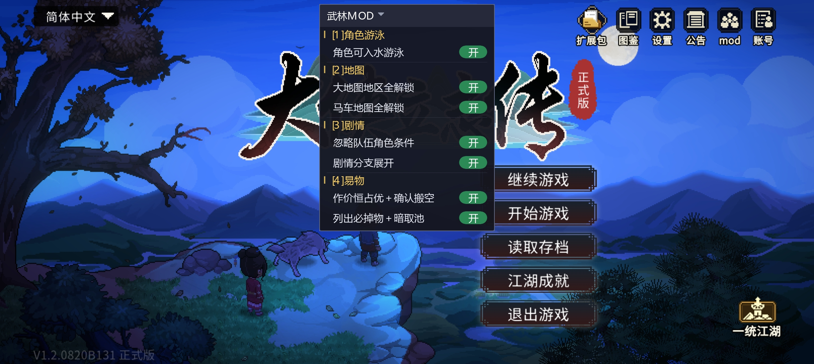

# WulinTweaks Mobile —— 大侠立志传 手机版（国际版）改造

《大侠立志传》安卓国际版（`com.xd.dxlzz.global.gp`）的功能补丁，纯 native 注入（`libwulin.so` + `libil2cpp` stub），不依赖任何 mod 框架。
与 PC 端 [WulinTweaks](https://github.com/jingleboat/WulinTweaks) 同一套规则、两端行为对齐。



面板默认展开、点标题栏折叠；分组与 PC 版一致（`[1] 角色游泳 → [2] 地图 → [3] 剧情 → [4] 易物`）。

---

## ⚠️ 重要提示：一个会关掉柳月樱线的坑

> **无名渡口与富商对话，剧情条件放宽会和诸葛神机前往海蛟帮，会变为「海蛟帮贵客」，导致柳月樱事件关闭。**

机制：剧情条件放宽后，海蛟帮支线 `M5030-0` 会比你预想的更早推到底，给存档打上 `海蛟帮贵客` 标记。
而柳月樱引子图 `R10049-0` 的作废条件之一正是这条标记 —— 标记一旦存在，引子图立刻变 `Failed`，
`R10049-2`「护花使者」及之后整条线永久关闭。

**想走柳月樱线，就在九黎部落拾取社稷之印之前，先把大梁城城门口那场「帮忙解围」做掉。**

已经踩坑的话，存档层面可以救：

1. 从 `SaveObjectStory.save` 的 `TagString` 里删掉 `海蛟帮贵客`
2. 把 `R10049-0` 的 `State` 重置为 `0 (NotOpen)`
3. 按攻略重走：**进大梁城客栈 → 回城门口 → 选「上前帮忙解围」** → 打赢拿樱花香囊

⚠️ **只把 `State` 改成 `4` 是无效的。** `StoryManager.StoryComplated` 开头有一段掩码判断
（`0x92` = bit1|bit4|bit7），State 已经是 4 就直接 `ret`，后面「注册后续图」的逻辑不执行，
`R10049-2` 永远不会被加载。必须让它真正走完一次。

---

## 功能

| 功能 | 说明 |
|---|---|
| 剧情条件放宽 | 放宽「某角色是否在队 / 是否有伙伴」这类条件，让不同队伍组合也能触发剧情。`R{角色id}-*` 图在本命角色从未入队时仍按原版（角色入队后才开自己的故事线）。**v95：含「结缘界面」`ShowUIBondsNode` 的图一律不放宽**（那类图收尾会写情缘/武功/buff，人不在队会写坏人物数据；与 PC 1.11.19 一致） |
| **剧情分支展开** | 把「某角色是否在队」的互补门对（`Negate=0/1`）由 **if/else 改成顺序播放**：先播在队侧的内容，再播不在队侧的内容。**通用规则**，不限定某张图（跳过嵌套门对 / 无出口 / 两侧都不是单节点剧情的情形）。v87 起接管层与 PC 一致：被展开的门在 `HoldNode.CheckCondition` 后**整门判真**，与门挂的是哪类条件无关 |
| **剧情期间显真名** | 剧情对话期间把出场角色从「陌生时姓名」（`@冷峻严肃的中年人`）换成**熟悉后姓名**（模板姓+名）。只作用于当前正在播的那张图；剧情收尾、换图、读档后还原。**v86 起不再带称号**（v84/v85 两版实测都不生效，见版本表） |
| 伙伴离队容错 | 「伙伴邀请或离队」要踢一个不在队（或队伍没那么多位置）的角色时，视为已成功，避免剧情卡死 |
| 大地图解锁 | 解除世界地图可去城市的限制 |
| 马车地图解锁 | 解除马车可去地点的限制 |
| 水面可走 | 可进入水域（含入水状态） |
| 易物强化 | 两个开关：作价恒占优（**含确认搬空**、空手也能成交）、列出必掉物＋暗取池 |
| 游戏内面板 | 屏幕顶部居中，分组与 PC 版一致：[1] 角色游泳 → [2] 地图 → [3] 剧情 → [4] 易物，逐项开关 |

主界面「鸣谢」按钮的显示文字被替换成 **mod**（手机版把这一格当 mod 入口用）。

---

## 目录

```
native/src/
  wulin_main.cpp   入口、条件 hook、姓名替换（播放窗口）、离队容错、地图解锁、日志
  flatten.cpp      剧情分支展开（通用规则：门对 → 独占内容区 → 出口改指 → 门判真）
  trade.cpp        易物（作价恒占优含搬空 + 池子）
  water.cpp        水面可走
  ui.cpp           游戏内面板（顶部居中）
  hook.cpp         arm64 inline hook 框架（自建跳板，含内部跳转绝对化）
  probe.cpp        诊断（#if WULIN_PROBE）
  common.h         全部 RVA 与结构体字段偏移（绑定 V1.2.0820B131）
  glyphs.h         面板文字字库（由 gen_glyphs.py 生成，别手改）
  stub.s           注入引导桩
native/build.ps1   NDK 构建脚本
mk_apk.py          APK 重打包
gen_glyphs.py      生成面板文字字库 glyphs.h
tools_hookaudit.py 审计 hook 目标前 4 条指令（内部分支/字面量/条件跳转是否安全）
```

> 2026-10-23 清理：早期逆向阶段的一次性脚本（`sv_*` / `dis_*` / `find_*` / `fix_*` /
> `patch_v*` / 存档扫描等，共 156 个文件）已删除，只保留构建与长期可复用的工具。
> 需要那批脚本时从 git 历史里取：`git log --diff-filter=D --name-only`。

---

## 构建

需要 Android NDK（`build.ps1` 里默认 `android-ndk-r27c`）。

```powershell
cd native
pwsh -File build.ps1            # → libwulin.so + stub.bin
```

打包（替换 APK 里的 so）：

```powershell
python -X utf8 mk_apk.py build --src <上一版.apk> --out $tmp --no-sign `
    --replace "lib/arm64-v8a/libwulin.so=<绝对路径>"
& "<build-tools>\zipalign.exe" -p -f 4 $tmp $al
$env:JAVA_HOME="<jdk>"
& "<build-tools>\apksigner.bat" sign --ks keystore\wulin.jks --ks-pass pass:<pass> `
    --ks-key-alias wulin --out <最终.apk> $al
```

> ⚠️ **`mk_apk.py sign` 自带的 `keystore/wulin.pem` + `wulin.crt` 与已装版本的 `wulin.jks` 不是同一套证书**，
> 用它签名会 `INSTALL_FAILED_UPDATE_INCOMPATIBLE`。必须走 `apksigner` + `wulin.jks`。
> 一致性校验：`apksigner verify --print-certs`，SHA-256 应固定不变。

---

## 版本

只列功能节点，中间的调试版本见 git 历史。

| 版本 | 内容 |
|---|---|
| v50 | 伙伴离队容错（按 ID） |
| v54 | 离队容错补 `mode=1` Index 越界 |
| v55 | `ContinueArrange` 看门狗阈值 16 → 256（修释法寺剧情播完卡死） |
| v56–v57 | 面板改屏幕顶部居中 / 贴顶 |
| v58 | 主界面「鸣谢」按钮文字改为 mod |
| v63 | 跳板内部跳转绝对化（修 `TMP.get_text` 钩子导致的读档栈溢出） |
| v69 | 剧情分支展开首次跑通（只针对 `R10049-2`，靠 `conditionPort` 认门） |
| v70 | 修 `team_ids` 读 il2cpp 数组漏 `+0x20`；展开改为不写 `partnerID/Negate` |
| v77 | 姓名落点确定为角色实例 `m_surName / m_givenName` |
| v78 | 性能收口：类指针缓存、展开缓存扩到 16 槽、日志分类计数 |
| v79 | 姓名只在「剧情真正播放期间」生效（`OnActive` / `Continue` 界定窗口） |
| **v80** | 分支展开改**通用规则**（不再限定某张图，A/B 类都展开）；姓名窗口改事件驱动（`Continue` 只续期 30s、新增 `StoryCloseNode.OnResult` 收尾信号）；**改名提到 `OnActive` 原函数之前**，修首句闪陌生名 |
| v81 | 易物「搬空」改走合并版 `AddItem`（修同类物品被拆成多堆）；克隆 `craftLevel` 传 0 不再滚随机锻造属性；新增同 ID 重复堆归并 |
| **v82** | 池子副本改「合并进同类堆 + 数量记账」（不再跳过背包已有的同类），池子里的东西不再漏；台账改「池子扣干才记」，分次拿也能拿完 |
| **v83** | 「确认搬空」不再是独立开关，跟随「作价恒占优」（与 PC 1.11.5 同步）；面板改**分组布局**（[1] 角色游泳 / [2] 地图 / [3] 剧情 / [4] 易物，与 PC 顺序一致），行高可变、面板高度按行表现算 |
| **v84** | 剧情里的名字从「姓+名」改成「称号·姓名」：名字来源换 `get_RealFullNameWithTitle`（`0x223B998`）—— **实测无效**（显示层不读 getter 返回值） |
| **v85** | 同样是「称号·姓名」，但改在**数据层**：拼 `称号 + "·" + 姓 + 名`（称号 = `get_Title` / 模板 `PersonalTitle`）后整串写进 `m_givenName`、`m_surName` 置空（与 PC 1.11.7 同步）—— **手机端实测仍显示「洛天雄」，该 UI 三条路都不走** |
| **v86** | 回退称号功能，名字恢复成模板「姓+名」（与 PC 1.11.8 同步） |
| **v87** | 剧情展开**接管层对齐 PC**：新增「门级接管」—— 被展开的门在 `HoldNode.CheckCondition` 之后整门判真（`flat_add_gate` / `flatten_gate_forced`），不再依赖「门挂的是伙伴/在队条件」；恒真表去掉 `F_FLAT` 判据（中途关开关不会出现「线已改、门不判真」）；冲突判定把超上限 region 也算进来（与 PC 一致） |
| **v88** | 固定名单（不放宽）追加 `R20004-6`（伙伴的故事，包打听离队那段）；与 PC 1.11.9 同步 |
| **v117** | 水域按实测两文件正确落地：**504 = 760 − 96（桌面 `504.txt`，首数是场景名已去掉）+ 12（`E:\笔记\504.txt`）= 676 格**；**2160 = 177 格（两版数据一致，维持不变）**。`gen_water_mask.py` 支持 EXCLUDE + ADD + REPLACE 三种覆盖 |
| **v115** | 水域：**504 = prefab ∪ 504.txt（并集，仍 760 格，因为 96 格本来就在水域里）**、**2160 = 2160.txt 整表（177 格）**；并新增 `CreateRoleMar.CreateNpc` 强制定位 —— 手机端不读 `ForceNPCSwim`（v113 的覆写从未被调用），改在角色创建那一刻把落点换成最近的水域格 |
| **v114** | 水域烤表按实测覆盖：504 从 760 格**减掉 96 格**（`native/water_data/504.exclude.txt`，与烤表命中 96/96 → 664 格）；2160 整表替换（`2160.replace.txt`，与 prefab 完全一致 177 格，无实际变化）。生成器自动应用，`gen_water_mask.py --check` 可复验 |
| **v113** | 方案A：覆写 `GameConfig.GetConfigStr("ForceNPCSwim")`，让名单里的 NPC 落点被放进水域格（id 列表写在 `native/src/water.cpp` 的 `FORCE_SWIM_IDS`） |
| **v112** | 水面排查诊断包：`MapEntity.IsBlock/IsSwimGrid` 双挂 + 四个钩子与 `Role.CheckInBathWater` 打点（只在烤表地图、每条前 40 次）+ 每秒状态行。为查「手机端角色走不到水面上」 |
| **v111** | 固定图加回 `R20004-6`（用户要求） |
| **v110** | 固定图改正则（`Guide10099-` 整族 + `Fame-2`）；**结缘图判定提到放宽链最前**（修月老祠不生效） |
| **v109** | 放宽改为「每图只放宽一次」；移除固定名单 |
| **v108** | times 压制去掉 R 图整族豁免 |
| **v107** | join 的 `leaveTeamMap` 缺省填 -1 |
| **v106** | join 补「可入家园」（CouldBackToFief + leaveTeamMap + UnlockInviting） |
| **v105** | join 去掉名字查找、修“已在队”闪退、新增解除陌生 |
| **v104** | join 开启结缘（SetBond + 情缘武功 + buff） |
| **v103** | join 改走游戏自身 `HasCharacterAsMember`/`AddCharacter` |
| **v102** | 名字查找前校验角色池是数组（修闪退） |
| **v100–v101** | join 查重实验（会崩）→ 回退 |
| **v99** | join 最小版：只入队（走已验证的队伍 List 链） |
| **v98** | join 全链路加类名校验 |
| **v97** | join 兼 hook `InvokeCommandInternal`（Enter 键） |
| **v96** | 控制台指令 `join <人物ID\|人物名> [1]`（**静默**，命中即吞、不打印任何文字）：入队 + 解除陌生（`初次见面=1`、双向好感 100、清 `m_surName/m_givenName`）+ 可入家园（`CouldBackToFief` + 队友状态 `leaveTeamMap` + `StoryManager.WriteString("UnlockInviting-<uid>")`）+ `1` 追加结缘（`SetBond` + 情缘武功 + 85xx/89xx/88xx buff）；死亡先 `SetAlive(true)`。挂 `ConsoleUI.InvokeCommand(string)` @0x244FA1C，与 PC 1.11.21 对齐 |
| **v95** | 放宽规则新增一条：**含「结缘界面」（`ShowUIBondsNode`）的图跳过放宽**，走原版「必须在队」。判定方式：扫 `graph.nodes` 逐节点问 IL2CPP 类名（按图指针缓存 64 槽），扫不到就退回 12 张已知结缘图名表；与 PC 1.11.19 同步 |
| **v89** | 撤销 `Fame-6`（楚襄兵祸）的固定名单条目（实测不需要）；清掉测试期日志：称号诊断 `[probe]`、「getter 不在窗口」逐次日志、门强制放行日志；文本层/气泡改名日志各限 8 条（与 PC 1.11.10 同步） |
| **v90** | **修「人物名字偶发显示成 `OutPort`」**：名字模块原来把「陌生名 / 熟悉后姓名 / 原始姓 / 原始名 / 模板原陌生名」当 `void*` 缓存托管字符串，而这些字段随即被我们覆盖 → 那串在托管堆上失去引用、被 GC 回收；之后还原/显示用的是悬空指针，内存被别的字符串复用（本 mod 展开剧情图时每次都 `il2cpp_string_new("OutPort")` / `"conditionPort"`，正好是同尺寸块）就把名字显示成 `OutPort`。改为**只缓存文本快照**（UTF-8 / UTF-16），需要字符串时现 new；槽位腾退时先还原再清空 |
| **v91** | 名字写入前加**类型校验**：实例必须 `GameCharacterInstance` 且 `m_templeteUid` 等于槽位 uid，模板必须 `CharacterPoolData` 且 uid 一致，不符就跳过（离队/换图后实例地址可能被复用）。同名校验也加在「还原」与「模板改名」两处 |
| **v92 / v93** | 排查探针（默认关，`WULIN_NAMEPROBE`）：TMP 里出现纯 ASCII 短串就记一条并带 GameObject 名；名字 getter 返回 ASCII 名时记一条并 dump **实例的 `m_surName`/`m_givenName` 指针+文本**与**模板四个名字字段**。靠它定位到：`OutPort` 出在实例 `m_givenName` 上，模板是干净的；显示位置是 `HeadName`（头顶名牌）与 `Text (TMP)`（对话/信息面板），两者都读 `get_FullName` |
| **v94** | **读侧消毒**（最终修法）：`get_FullName` / `get_FullNameWithTitle` 返回值若是「端口名式纯 ASCII 串」，就用模板重新算一个该显示的名字返回 —— **不写任何游戏字段、不碰存档**，头顶名牌与对话/信息面板同时恢复正常 |

---

## 「名字变成 OutPort」排查记录（v90 ~ v94）

**症状**：剧情里对话正常；**触发洛天雄离队后**再去他离队后的位置，名字显示成 `OutPort`（头顶名牌与对话面板都是）。

**逐层否证**（每层都有日志/探针证据，避免以后再走一遍）：

| 步骤 | 结论 |
|---|---|
| 存档查证 | Save0/Save1 里 `m_surName=""`、`m_givenName="@冷峻严肃的中年人"`，全文 0 处 `Port` → **存档是干净的，坏值只在内存** |
| v90（GC 悬空指针） | 真实存在且已修（缓存托管字符串裸指针 → 被 GC 回收后复用），但**不是**这个症状的唯一来源 |
| v91（类型校验） | `实例不可信 / 模板不可信` 一次未触发，`已把实例姓名改成` 全是正常中文名 → **不是我们写名字那一步写坏的** |
| v92（TMP / getter 探针） | `get_FullName → "OutPort"`，`cls=GameCharacterInstance`；TMP 侧 `go="HeadName"`、`go="Text (TMP)"` |
| v93（字段 dump） | `sur=…""`、**`giv=…"OutPort"`**，而 `tpl` 的 `uName="洛天雄" / 陌生名="冷峻严肃的中年人" / 姓="洛" / 名="天雄"` → 坏在**实例字段**，模板没问题；写者未知（唯一能确认的是：不是本 mod 的改名/还原路径） |
| v94（读侧消毒） | 在这两个 getter 出口把「端口名式 ASCII 串」换回模板算出的名字，两处 UI 同时正常，且不写游戏对象、零风险 |

**遗留**：把 `OutPort` 写进实例 `m_givenName` 的那个写者还没定位（`[partner] remove uid=… 不在队 → 视为成功，跳过原版` 之后出现）。要彻底查需做「完全不写名字字段」的对照包（dry-run）逐步二分；v94 已在读侧把症状挡住。

---

## 易物搬空：同类物品堆叠（v81 / v82）

**症状**：易物确认搬空后，队伍背包里同一种可堆叠物品变成两三堆，且不会再自动合并。

**根因**（反汇编 `libil2cpp.so` 确认）：`GameItemPack` 的两个加物品接口行为完全不同——

| 接口 | RVA | 行为 |
|---|---|---|
| `AddItem(item, needCheck)` | `0x227DD64` | 可堆叠时委托 `AddItem(ItemData,count)`：遍历 `contents` 找同 `Templete` 的堆并 `m_stack += count` → **合并** |
| `AddItemAsIndependent(item)` | `0x227DF18` | 校验后直接 `contents.Add(item)` → **永不合并** |

旧版 `transfer()`（搬空：交易区/NPC 背包 → 队伍背包）用的是后者，于是每件都成独立堆。
`IsStackable` = `Templete.IsStackable && modifyData == null`，所以克隆时 `craftLevel` 必须传 **0**——
传 `-1` 会让 `CreateForgeModify` 给可锻造装备滚一份随机附加属性。

**现在的规则**：

1. 搬运一律 `AddItem`（合并）；先扣源再合并写目标，目标拒收就把原件数量还原后塞回源。
2. 池子副本两种形态：背包**没有**同 ID → 独立实例（按实例删/记账）；背包**已有**同 ID →
   **合并进那一堆**，按数量删/记账。合并形态保证池子里的东西不会因为「背包已有同类」而漏掉，
   面板也不会出现两个同 ID 堆。
3. 取消面板只撤我们加进去的那部分（`当前数量 − 合并前数量`），绝不碰 NPC 原货。
4. 台账只在「池子里这件被扣干」时才记 —— 只拿一部分时下次开面板还能补剩下的；
   模板条目没有实物可扣，仍然一次记掉（防止无实物无限生成）。
5. 开易物面板与搬空后各跑一次 `merge_dup_piles()`，把老存档里已经被拆开的同类堆并回一堆。

---

## 水域：水面可走 + 入水形态（技术归档，2026-10-25）

> 与 PC 端同源结论（PC 侧完整版见 `wulin-mod/README.md` 的「水域 / 入水机制」）。

### 1. 手机为什么必须「烤表」

游戏用地图 prefab 里的 `_SwimGrid`（Tilemap）定义水域格，**只有 504 / 2160 有数据**
（504 = 760 格、2160 = 177 格、2169 = 0 格）。

现状要分两层说清（2026-10-25 复核）：

- **数据层：原版手机 APK 里就有**。`assets/aa/Android/prefabs_map_assets_assets/_artwork/map/prefab/`
  下的 `map_504.prefab.bundle` 里 `_SwimGrid` = 760 格 + `_SwimLadder` 8 格，`map_2160.prefab.bundle`
  里 177 格 + 2 格，与 PC 的 `_SwimGrid` 逐格一致（`gen_water_mask.py --check` 可复验）。
- **运行层：v6x~v7x 的设备探针当时看到的是「运行期地图实例只有 24 个图层、没有 `_SwimGrid`/`_SwimLadder`」**，
  于是判断 `mSwimGrid` 全零、`IsSwimGrid` 恒 false —— 这也是当初做烤表的原因。
- ⚠️ 但 v112/v113 的诊断日志（`[water] ME.IsSwimGrid(x,y) 原值=…`）能直接验这一条：
  **只要出现 `原值=1`，就说明原版手机其实认水域格，烤表只是"兜底/补漏"而不是"无中生有"**。
  这条待日志确认后要回来改本节措辞。

因此 `water_mask.h` 由 `gen_water_mask.py` 从 APK 地图 prefab 里把 `_SwimGrid` 烤成坐标表，
运行期用 `water.cpp` 的两个钩子顶替：

| 钩子 | RVA（V1.2.0820B131） | 作用 |
|---|---|---|
| `MapManager.IsBlock` | `0x2395B74` | 烤表命中 → 返回 false（水面可走） |
| `MapManager.IsSwimGrid` | `0x2395AB8` | 烤表命中 → 返回 true（触发入水形态） |

坐标空间已核对一致：`Role.CheckInBathWater` 内部用 `WorldToCell(transform.position)` 取格，
与烤表里的 tilemap 格坐标同一套；`Vector3Int` 在 ARM64 上按 `x1 = x | y<<32`、`x2 = z` 传递。

### 2. 判定链（与 PC 完全一致）

```
cell = tile ?? WorldToCell(transform.position)
swim = MapManager.IsSwimGrid(cell)      ← 唯一判据，不看 id / 性别 / 形象
if (swim == Role.IsInBath) return       ← 幂等
Role.IsInBath = swim; SetBathing(swim); CreateRoleGhost; Animator.SetFloat("IsBath", swim?1:0)
移速 = CharMoveSpeedInWater; 影子隐藏
```

调用点只有：`Role.OnMove`（每走一格）、`CreateRoleMar.CreateNpc/CreatePlayer`、剧情
`MoveNode`/`JumpToDestination`/`ChangeNpcDestination`。**站着不动不会被调用。**

### 3. 两个已知限制（都不是钩子的问题）

1. **站桩不触发**：被直接放进水格、之后不移动的角色，没人替她调 `CheckInBathWater` →
   `IsInBath` 一直是 false、`IsBath` 参数一直是 0。可以加「状态自愈」（节流遍历场景角色，
   把 `IsInBath` 与 `IsSwimGrid(脚下格)` 对齐后补调一次）来解决。
2. **没有水中形象的角色，入水也不显示游泳**：游泳观感由形象资源决定 ——
   `{B|Z}{形象}_Wash*` 动作（160 条 / 78 个形象）+ `{形象}w` 贴图集（40 套）。
   没有这两个资源的形象（例如 177）即使 `IsBath=1`，动画也只能继续播 `stand/walk`，
   看起来就是「站在水面上走」。这是数据层，mod 改不了。

### 4. `ForceNPCSwim`

`GameEnvConstStrData` 里的 `ForceNPCSwim`（官方值为空）是「把某些 NPC 的落点放进家园水域格」的开关，
进入水域图时由 `GameConfig.GetConfigStr` 读；它**只改落点**，不负责入水状态与动作。
实测：填 `10033` 后该角色从陆地落点变成 504 的水域格。

## 已知限制

- 放宽只作用在 `Negate=0` 一侧，同一图里 `需要伙伴(X)` 与 `需要伙伴(X, Negate=1)` 可能同时成立 ——
  这是有意保留（流程内放宽），容错补丁只兜底「动作落空」，不解决走错分支。
- 剧情分支展开：**B 类（两侧都是剧情）会被串起来都播**。若某张图两侧本来是互斥内容，
  可出现"同一情节演两遍"或动作节点副作用叠加；手机端没有黑名单配置，遇到只能在面板第 8 行整体关掉。
- 剧情期间的姓名窗口没有「剧情收尾」以外的结束信号，`StoryCloseNode` 若不走，名字会多留最多 30 秒。
- 易物副本合并进同类堆后，「拿走多少」是按 `(背包原数量 + 副本量) − 剩余` 推断的；
  混合堆里分不清玩家拿的是原货还是副本，这里按「先算副本」处理，极端混拿时池子扣减可能偏少
  （方向保守，不会产生无限刷）。整堆「搬空」是精确的。
- RVA 与字段偏移绑定 **V1.2.0820B131**，换游戏版本必须重新标定。
